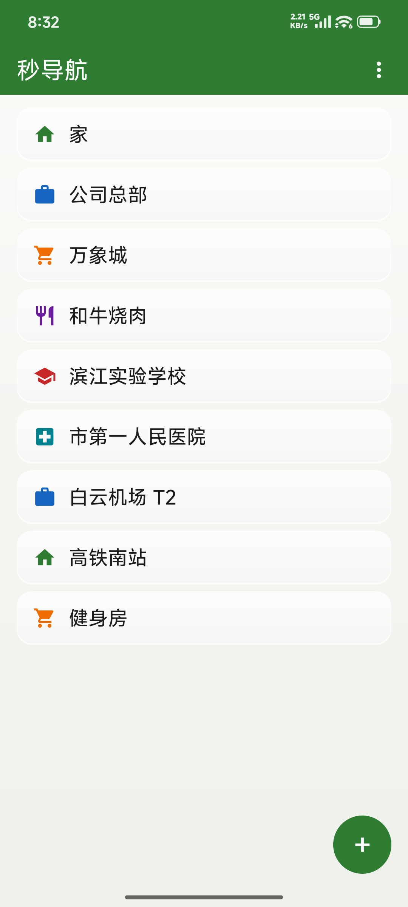
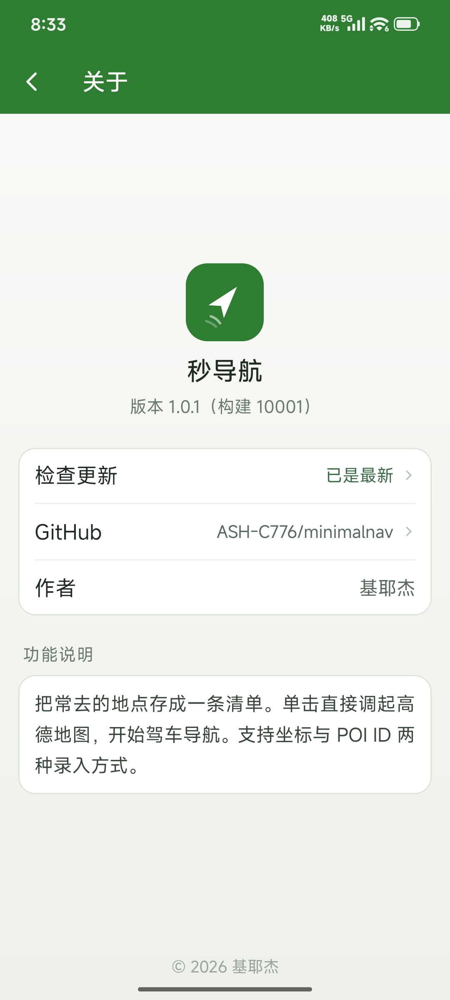

# 秒导航 · MiaoNav

一个只做一件事的安卓应用：**点一下，直接进高德导航**。

不集成地图 SDK，不申请定位权限，不需要任何地图开发者 Key。装好以后录几个常去的地点，之后每次出发只要点一下，不用再翻高德的收藏夹。

**版本 1.0.1** · Android 6.0+（minSdk 23）· 冷启动 313–367 ms

---

## 它解决什么问题

高德地图本身很好用，但它不是一个"出发"工具，而是一个完整的出行平台。想从一个常去的地方出发，完整路径是：

> 打开高德 → 我的 → 收藏 → 找到那个地点 → 点进去 → 开始导航

五个动作，就为了每天重复几十次的一件事。

系统快捷方式也不解决问题：桌面图标只能放有限几个，而且指向固定的地点，换个地方就得重来；想整理顺序、改名字、批量管理，都做不到。

而市面上带"导航聚合"的第三方 App，为了提供一次跳转，往往自带一整套地图渲染、推荐流和广告，安装包几十 MB，还要定位、网络、存储一堆权限。

**秒导航的取舍是：不做地图，只做"出发"。**

清单里就是几个名字，点一下唤起高德开始驾车导航。没有地图渲染，没有位置上报，没有账号，数据只存在你自己的手机上。

---

## 功能

| 功能 | 说明 |
|---|---|
| 一键驾车导航 | 单击清单任意一条，直接调起高德开始导航，不弹菜单、不二次确认 |
| 坐标录入 | 填 GCJ-02 经纬度 + 备注名 |
| POI ID 录入 | 只填高德 POI ID，点击时打开高德 POI 详情页再导航 |
| 长按菜单 | 路线规划 / 上移 / 删除，竖排浮层，靠右显示 |
| 导入导出 | JSON 格式，默认写入手机 `Download/秒导航YYMMDD.json`，同一天重复导出自动加序号 |
| 沉浸式界面 | edge-to-edge，状态栏与手势条全程沉浸 |
| 在线更新 | GitHub + Gitee 双源检查，24 小时节流，安装前校验版本号 |
| 一屏九条 | 52dp 紧凑卡片，1080×2400 屏幕一屏放下 9 个常用地点不滚动 |

## 界面

| 清单 | 关于 |
|---|---|
|  |  |

> 截图中的地点名与坐标为演示数据。

---

## 怎么录入一个地点

秒导航不做搜索，所以录入前需要你先从高德拿到坐标或 POI ID。两种方式任选其一。

**坐标方式**（推荐，点击后一步直达导航）

在高德地图里长按目标位置 → 底部出现"选定地点"→ 点进详情 → 分享 → 复制链接，链接里的 `position=经度,纬度` 就是需要的一对数字（注意高德是经度在前）。

**POI ID 方式**（适合只知道地点、懒得取坐标）

在高德里搜到目标地点 → 进入详情页 → 分享 → 复制链接，链接里 `?picid=` 或 `poiid=` 后面那串字母数字就是 POI ID。

两个信息都只能从高德自己的分享链接里取，秒导航不做任何抓取，也不联网查询。

---

## 技术实现

### 零地图 SDK：把导航交给高德自己

整个应用没有一行地图渲染代码，也没有引用任何高德 SDK。所有导航能力都通过高德官方的 URI Scheme 交给高德 App 完成：

| 场景 | URI |
|---|---|
| 开始驾车导航 | `androidamap://navi?lat=&lon=&poiname=&dev=0&style=2` |
| 路线规划页 | `amapuri://route/plan/?dlat=&dlon=&dev=0&t=0` |
| POI 详情页 | `https://uri.amap.com/poidetail?poiid=&callnative=1` |

这么做换来三个结果：

1. **不需要开发者 Key。** 这些 URI 是高德对外开放的入口，不校验 Key，也就不需要实名申请、不需要担心配额。
2. **不需要定位权限。** 起点由高德用自己的定位能力决定，秒导航从头到尾不知道你在哪。
3. **包体只有 3.5 MB。** 没有 SDK 就没有 amap 的 so 库和资源。

代价是导航界面完全由高德决定，秒导航无法定制路线偏好、无法显示实时路况。这是刻意的取舍——这些事高德做得比自己好。

### 数据层

`SharedPreferences` 存一个 JSON 数组，结构极简：

```json
[{ "name": "公司总部", "hasCoord": true, "lat": 23.1322, "lon": 113.3245,
   "poiId": "", "colorIndex": 1, "iconIndex": 1 }]
```

纯 POI ID 条目的 `lat` / `lon` 存 `NaN`，`hasCoord=false`，点击时走 POI 详情页分支。导出格式带 `app` / `version` / `exportedAt` 字段，导入时兼容旧版裸数组，并逐条校验——单条数据坏了不会让整次导入失败。

### 在线更新：双源 + 节流 + 安装前校验

- 启动 3 秒后静默检查，24 小时内最多一次；关于页手动点击会绕过节流
- 并发请求 Gitee 与 GitHub 的 Release API，Gitee 命中后只给 GitHub 4 秒补充机会——否则国内访问 GitHub 会卡满超时，弹窗要等近 10 秒
- 版本号公式 `major*10000 + minor*100 + patch`，客户端与服务端解析必须完全一致
- 下载完先校验待安装 APK 的 `versionCode`，不高于当前版本直接拒绝——防止传错包导致"版本相同还提示更新"
- 用 `FileProvider` 暴露 `filesDir/update/` 一个目录，交给系统安装器完成覆盖安装

### 启动性能

启动路径上每一个决定都是量过之后才做的：

| 做法 | 效果 |
|---|---|
| 顶部栏不用 `Toolbar`，改 `FrameLayout + TextView + ImageView` | 省掉 ActionBar 与主题属性解析，首帧膨胀 108–114 ms → 92–93 ms |
| 浮层用 `ViewStub` 按需膨胀 | 绝大多数启动不会打开菜单，不为 `GONE` 的覆盖层付出三个容器的代价 |
| 列表行压成单层 `LinearLayout` | 9 行少 18 次 measure/layout |
| 图标 `setImageResource + setColorFilter` | 避免每次绑定都 `mutate()` 打破 Resources 缓存 |
| 精确 `notifyItem*` + `setHasFixedSize(true)` | 增删一行不重绑整表 |

实测（Xiaomi Civi 3，release 构建）：冷启动 **313 / 335 / 367 ms**，`FullyDrawn − Displayed ≤ 16 ms`，首帧即完整内容，没有"先白壳后补内容"。

也测过 baseline profile，收益落在噪声范围内，文件保留但对本机型无实际作用。

### 沉浸式适配

`EdgeToEdge` 统一处理 WindowInsets：状态栏延伸深绿头部背景（浅色图标），手势条区域延伸页面背景（深色图标）。底部浮层用 Activity 内覆盖层实现而不是 `Dialog`——Dialog 会另开窗口，在 MIUI 上会把手势条变成灰白条，且点击外部无法关闭。

---

## 构建

需要 JDK 17+ 与 Android SDK（compileSdk 36）。

```bash
./gradlew assembleDebug
```

产物在 `app/build/outputs/apk/debug/app-debug.apk`。

`local.properties` 需要自己创建，写入本机 SDK 路径：

```properties
sdk.dir=/path/to/Android/Sdk
```

## 项目结构

```
MinimalNav/
├── app/src/main/
│   ├── java/com/example/minimalnav/
│   │   ├── MainActivity.java          — Main screen: list, popover overlay, import/export, update entry point.
│   │   ├── AddAddressActivity.java    — Add-address screen with coordinate and POI ID input modes.
│   │   ├── AboutActivity.java         — About screen: version, update check, GitHub link.
│   │   ├── Address.java               — Data model for one saved place.
│   │   ├── AddressStore.java          — Persistence and JSON import/export logic.
│   │   ├── AddressAdapter.java        — RecyclerView adapter with focus highlighting.
│   │   ├── Palette.java               — Six colors and six icons used by list rows.
│   │   ├── EdgeToEdge.java            — WindowInsets helper for immersive system bars.
│   │   ├── UpdateChecker.java         — Concurrent release lookup against GitHub and Gitee.
│   │   ├── UpdateInfo.java            — Release metadata and version-code parsing.
│   │   ├── UpdatePrefs.java           — Check throttle and dismissed-version record.
│   │   └── UpdatePrompt.java          — Update dialog, APK download, version check, installer handoff.
│   ├── res/layout/                    — Screen and row layouts.
│   ├── res/drawable/                  — Glass backgrounds, popover shapes, vector icons.
│   ├── res/mipmap-*/                  — Adaptive launcher icon plus density fallbacks.
│   ├── res/xml/file_paths.xml         — FileProvider path declaration for downloaded APKs.
│   └── baseline-prof.txt              — Baseline profile for startup classes.
├── docs/screenshots/                  — Screenshots used by this README.
├── gradle/                            — Gradle wrapper.
└── build.gradle                       — Root build script (AGP 8.13.2).
```

## 权限说明

| 权限 | 用途 |
|---|---|
| `INTERNET` | 仅用于检查更新（请求 GitHub / Gitee 的 Release API） |
| `REQUEST_INSTALL_PACKAGES` | 仅用于安装下载好的新版本 APK |

没有定位、没有存储、没有读取应用列表。导入导出走系统文件选择器与 `Download` 目录，不需要存储权限。

## 隐私

- 所有地点数据只存在本机 `SharedPreferences`，不上传任何服务器
- 更新检查只发送 HTTP 请求读取公开 Release 列表，不携带任何设备标识或用户数据
- 没有账号体系，没有统计 SDK，没有广告

## 相关链接

- GitHub：https://github.com/ASH-C776/minimalnav
- Gitee：https://gitee.com/kijeye/minimalnav

## 许可

个人项目，保留所有权利。
